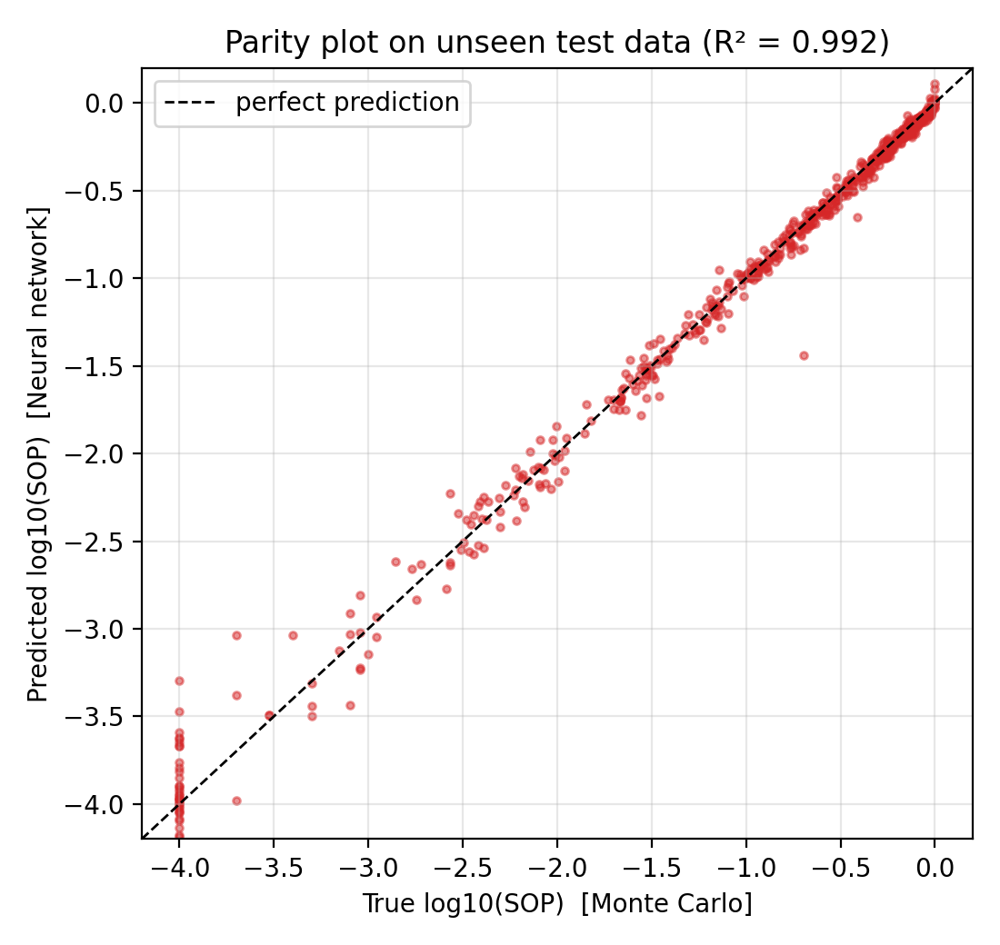
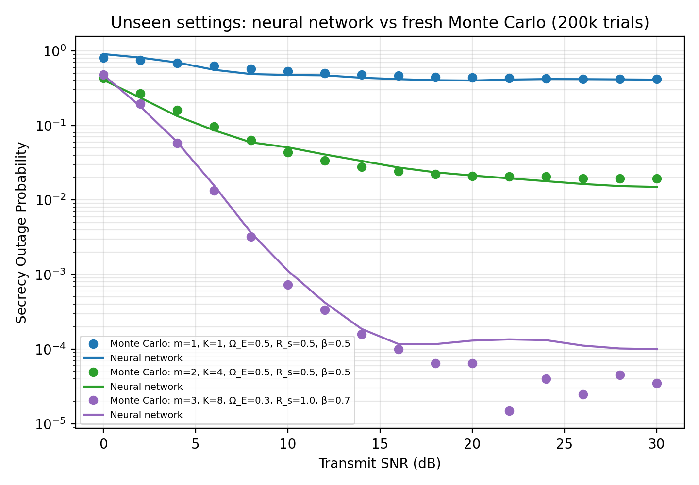

# Neural-Network Surrogate for Secrecy Outage Prediction in Backscatter IoT

[](https://colab.research.google.com/github/<your-username>/nn-sop-prediction-backscatter/blob/main/sop_prediction_nn.ipynb)

A neural network that predicts the **secrecy outage probability (SOP)** of ambient-backscatter
communication with optimal tag selection — about **14,000× faster** than Monte Carlo simulation.

**Author:** Mohammad Nafees, Ph.D. Scholar (ECE), MNNIT Allahabad
**Related work:** [arXiv:2503.12400](https://arxiv.org/abs/2503.12400)

---

## 1. Problem

For optimal tag selection (OTS) among K tags, a secrecy outage happens when the best tag's
secrecy capacity falls below a target rate:

- `C_s,k = [log2(1+SNR·β·|h_k|²|g_k|²) − log2(1+SNR·β·|h_k|²|f_k|²)]⁺`
- `SOP = P( max_k C_s,k < R_s )`

SOP depends on **6 parameters**: SNR, Nakagami-*m*, K, eavesdropper gain Ω_E, R_s and β.
Evaluating it needs long closed-form expressions or thousands of Monte Carlo trials for every setting.

## 2. Idea — a surrogate model

1. Use the Monte Carlo simulator to label **4,000 random parameter settings** (10,000 trials each).
2. Train regression models: 6 parameters → `log10(SOP)` (log scale because SOP spans 1e-4 … 1).
3. Use the trained neural network as a fast **surrogate** of the simulator.

| Parameter | Range |
|---|---|
| Transmit SNR | 0 – 30 dB |
| Nakagami-*m* | 1 – 4 |
| Tags K | 1 – 8 |
| Eavesdropper gain Ω_E | 0.1 – 1.0 |
| Target rate R_s | 0.2 – 2.0 bit/s/Hz |
| Reflection coefficient β | 0.2 – 0.9 |

## 3. Results (unseen test data, 600 settings)

| Model | R² (log10 SOP) | MAE (log10 SOP) | Median relative error (SOP > 1e-3) |
|---|---:|---:|---:|
| Linear Regression | 0.722 | 0.431 | 41.0 % |
| Random Forest | 0.960 | 0.133 | 13.8 % |
| Neural Network (MLP) | 0.992 | 0.053 | 5.9 % |

- Neural network (MLP 64-64-32, ReLU, Adam, early stopping): **R² = 0.992**, median error ≈ 6 %.
- Speed: Monte Carlo (100k trials) ≈ 67 ms per SOP value; neural network ≈ 4.7 µs → **≈ 14,000× faster**.




More: [training curve](results/training_curve.png) · [learning curve](results/learning_curve.png) ·
[model comparison](results/model_comparison.csv) · [dataset](results/dataset.csv)

## 4. Honest limitations

- Labels come from 10,000 trials, so SOP below **1e-4** cannot be measured; the network therefore
  saturates near 1e-4 and is unreliable for very small SOP (purple curve). More trials or
  importance sampling would fix this.
- Accuracy is lower at the edges of the parameter ranges (e.g. K = 1 at 0 dB).
- Trained only on OTS with perfect CSI and Nakagami-*m* fading.

## 5. How to run

```bash
git clone https://github.com/<your-username>/nn-sop-prediction-backscatter.git
cd nn-sop-prediction-backscatter
pip install -r requirements.txt
python sop_prediction_nn.py
```

Or open `sop_prediction_nn.ipynb` in Google Colab → **Runtime → Run all** (≈ 2 minutes).

## License

MIT
